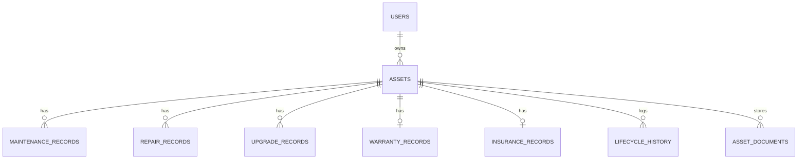

# Personal Asset Lifecycle Manager

Java 17 + Spring Boot 3 + Thymeleaf + Bootstrap 5 + MySQL 8.

## 1. Setup on Windows

1. **Install**: JDK 17 (Temurin), IntelliJ IDEA Community, MySQL 8 (you already have it). Maven is bundled in IntelliJ.
2. **Open** this folder in IntelliJ (`File > Open > asset-manager`). Wait for Maven to download dependencies.
3. **Lombok**: IntelliJ prompts to enable annotation processing - click *Enable*
   (`Settings > Build > Compiler > Annotation Processors > Enable`). Lombok writes getters/setters for us.
4. **Database**: nothing to create by hand - the URL has `createDatabaseIfNotExist=true`.
   (Or run `docs/schema.sql` in MySQL Workbench.)
5. **Edit** `src/main/resources/application.properties`: replace `YOUR_MYSQL_USERNAME` and `YOUR_MYSQL_PASSWORD`.
6. **Run** `AssetManagerApplication` (green play button). Or in a terminal: `mvn spring-boot:run`.
7. Open **http://localhost:8080** > *Create an account* > log in.
   Internet is needed in the browser (Bootstrap, icons, Chart.js load from a CDN).

## 2. How it fits together (simple explanation)

| Layer | Folder | Job |
|---|---|---|
| Model/Entity | `model/` | Java classes = database tables (`@Entity`). `AssetForm`/`RegisterForm` carry form data + validation |
| Repository | `repository/` | Interfaces; Spring Data JPA writes the SQL (INSERT/SELECT/UPDATE/DELETE) |
| Service | `service/` | Business rules: depreciation, health score, lifecycle history, notifications, reports |
| Controller | `controller/` | Receives the browser request (URL), calls services, returns a Thymeleaf page |
| Config | `config/` | BCrypt bean, login-check interceptor |
| Templates | `resources/templates/` | HTML pages; Thymeleaf fills them with data |

**Flow of a form**: browser form (`<form method=post action=/assets>`) -> `AssetController.create()` -> validates `AssetForm`
-> `AssetService.register()` -> `AssetRepository.save()` -> Hibernate runs `INSERT` on MySQL -> redirect to the details page.
**Java <-> MySQL**: connection details in `application.properties`; Hibernate (JPA) maps entities to tables.

## 3. Calculations

* **Depreciation (straight line)**: `annual = (price - salvage) / life`; `accumulated = annual x min(years owned, life)`;
  `current = max(price - accumulated, 0)`. No/invalid life => no depreciation. Disposed assets count as value 0.
* **Total lifecycle cost** = purchase + maintenance + repair + upgrade (all `SUM`s from the database, never stored).
* **Warranty / insurance status**: no date = NOT_AVAILABLE; past = EXPIRED; <= 30 days = EXPIRING_SOON; else ACTIVE.
* **Health score** starts at 100: age vs useful life (0/-10/-20/-30), condition (0/-5/-15/-30), repairs (-5 each, max -20),
  open repair (-10), overdue maintenance (-10) or none for an asset > 1 year (-5), expired warranty (-5).
  >= 75 GOOD, >= 50 FAIR, else NEEDS_ATTENTION. Reasons are shown on the details page.
* **Repair or replace** (rules, not AI): repair cost / current value >= 60% (or past life and poor/40%) => Consider replacement;
  >= 25%, pending repair, or Fair/Poor condition => Repair recommended; else Continue using.

## 4. DBMS concepts by module
* Auth: UNIQUE email, INSERT/SELECT, hashed passwords. Assets: PK/FK, NOT NULL, one-to-many (user->assets), search with WHERE/LIKE, ORDER BY, pagination (LIMIT).
* Maintenance/Repair/Upgrade: one-to-many, SUM aggregates, transactions (`@Transactional`: record + history + status change succeed or fail together).
* Warranty/Insurance: one-to-one (UNIQUE FK), date arithmetic. Dashboard/Reports: JOIN, GROUP BY, aggregates.
* Soft delete: DELETE is replaced by status = DISPOSED to keep history (referential integrity).
* Normalisation: totals are computed from child tables, not stored (3NF). See `docs/schema.sql` for sample queries.

## 5. ER diagram (Mermaid - paste in https://mermaid.live)

## 6. Java OOP used
Encapsulation (private fields + getters/setters), constructors (`User`), interface + polymorphism (`CostRecord` implemented by
Maintenance/Repair/Upgrade), method overloading (`AssetService.changeStatus`), records, exceptions (`ResourceNotFoundException`,
`GlobalAdvice`), collections (List, Map, Set).

## 7. Test cases (manual)
| # | Action | Expected |
|---|---|---|
| 1 | Register with weak password `abc` | Error: min 8 chars with letter and number |
| 2 | Register valid user, then login | Dashboard opens; wrong password shows error |
| 3 | Add asset (price 60000, salvage 10000, life 5, warranty end in 20 days) | Success message, details page, status ACTIVE, history "REGISTERED" |
| 4 | Add asset with future purchase date | Validation error |
| 5 | Edit asset name | Saved; history shows UPDATED |
| 6 | Dispose asset (confirm dialog) | Status DISPOSED, still visible with history |
| 7 | Maintenance: choose Yes, save with cost 500 | Totals on dashboard/details increase by 500; history entry |
| 8 | Repair status PENDING | Asset UNDER_REPAIR, notification "pending repair"; "Mark completed" returns it to ACTIVE |
| 9 | Warranty page: update dates | Status recalculated; <=30 days shows in alert + notifications |
| 10 | Insurance: add policy | Shown on details page |
| 11 | Depreciation | Annual = 10,000 for sample above; value never below salvage |
| 12 | Lifecycle cost | Purchase + maintenance + repair + upgrade on details page |
| 13 | Reports > Export CSV | CSV downloads, opens in Excel |
| 14 | Log in as 2nd user, open `/assets/1` of first user | "Asset not found" (no access) |
| 15 | Upload `.exe` as document | Rejected; PDF/PNG/JPG accepted |

Unit tests: `mvn test` (depreciation + warranty rules).

## 8. Diagrams for your report
Use case: User -> Register/Login, Manage assets, Record maintenance/repair/upgrade, Manage warranty/insurance, View reports/notifications, Upload documents.
Activity: Login -> Add asset -> (Maintenance? yes/no) -> (Repair? yes/no) -> Upgrade? -> Dispose.
Sequence (add asset): Browser -> AssetController -> AssetService -> AssetRepository -> MySQL -> back -> redirect.
Class diagram: entities in `model/`, `CostRecord` interface, services, repositories.
Future work: email reminders, PDF reports, edit/delete for all records, admin role.

## 9. Troubleshooting
* `Access denied for user` - fix username/password in application.properties.
* Red getters in IntelliJ - enable Lombok annotation processing.
* Port 8080 busy - add `server.port=8081`.
